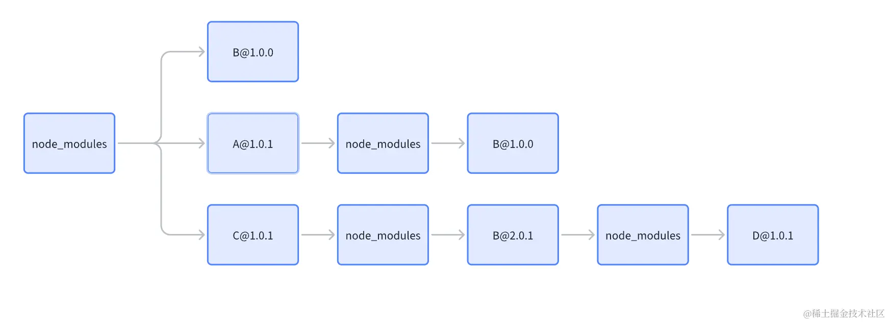

## npm 1/2 时代
http2针对头部字段，使用HPACK压缩算法，对请求头进行压缩。
1. 磁盘空间占用：每个依赖都会安装自己的依赖，导致了大量的重复，特别是在多个包共享同一依赖的场景下
2. 深层嵌套问题：这种嵌套结构在文件系统中造成了非常长的路径，然而大多数 Windows 工具、实用程序和 shell 最多只能处理长达 260 个字符的文件和文件夹路径。一旦超过，安装脚本就会开始出错，而且无法再使用常规方法删除 node_modules 文件夹
3. 安装和更新缓慢：每次安装或更新依赖时，npm 需要处理和解析整个依赖树，过程非常缓慢。

## npm3
过将依赖扁平化，尽可能地减少了重复的包版本，有效减少了项目的总体积，同时也避免了 npm 早期的深层嵌套问题。

## yarn
1. 性能提升：yarn 在发布之初就强调了性能优势，特别是在安装依赖时。它通过并行安装依赖和缓存已下载的包来加速这一过程，减少了安装时间。

2. 更好的依赖管理：yarn 引入了 yarn.lock 文件，这个锁文件确保了依赖的一致性。无论是在哪个环境下运行yarn install，都能确保安装相同版本的依赖，解决了因版本不匹配导致的问题。

3. 更好的安全性：yarn 通过检查安装的每个包的许可证，并提供了一种机制来限制或拒绝具有不安全许可证的包的安装，增强了项目的安全性。

### ！！幽灵依赖！！
其实扁平化的结构还是存在一些问题的，那就是幽灵依赖。
我们假设 B 并没有在 package.json 中注册，但由于 A 依赖 B，B会被提取到 node_moduls 顶层，那么在项目中就可以直接引用 B，这就是幽灵依赖，当 A 出现一些变动时（升级、删除），会导致出现几个问题：

- 环境不一致：由于该模块未在 package.json 文件中声明，当在其他环境（如测试、生产环境或者其他人的开发环境）中部署应用时将无法知道需要包含那些模块。这将导致环境之间存在不一致，可能会导致在其他环境中运行时出现错误。

- 版本控制问题：由于未明确声明依赖，可能会出现不同环境中使用的模块版本不一致的问题。这可能导致某些功能在某些环境中无法正常工作，或者出现不可预见的行为。

- 代码可读性和可维护性降低：开发人员无法清楚地了解应用程序的依赖项，导致代码理解困难。

而 pnpm 就是为了解决这个问题而出现的。

## pnpm
### 硬软链接概念
在了解 pnpm 具体机制之前，我们先了解一下硬链接和软链接（符号链接）的概念：

硬链接（Hard Link）

概念：硬链接是文件系统中的一个链接，它指向磁盘上的数据。当创建一个硬链接时，实际上是在创建一个和原始文件相同的入口点，但是不占用额外的磁盘空间。这个新的链接和原始文件共享相同的数据块，任何一个文件的修改都会反映在另一个上。
特点：硬链接不能跨文件系统创建，也不能用于链接目录，但如果原始文件被删除，硬链接依然可以访问数据。
使用场景：当你想要在不同位置访问同一个文件内容，而又不想占用额外磁盘空间时，可以使用硬链接。比如，在多个项目中共享相同的库文件，但不需要复制这个文件多份。

软链接（符号链接，Symbolic Link）

概念：软链接是一个特殊类型的文件，它包含了另一个文件的路径。类似于 Windows 系统中的快捷方式。与硬链接不同，软链接可以指向目录，也可以跨文件系统。
特点：软链接指向文件或目录的路径，如果原始文件被删除，软链接就会失效，因为它的指向已经不存在了。
使用场景：软链接适用于需要引用特定位置的文件

1. 全局存储：pnpm 从 npm 注册表下载包并存储在全局存储目录中，例如 ~/.pnpm-store/v6/files/sha512/xx/xx/xxxx....，通过内容寻址来区分不同内容的文件路径
2. pnpm 从全局存储创建硬链接到项目的本地存储，例如 projectA/node_modules/.pnpm/lodash 和 projectB/node_modules/.pnpm/lodash。这样做的目的是节省磁盘空间和加快安装速度。
3. 在项目的 node_modules 目录中，pnpm 创建符号链接指向本地存储中的硬链接，例如 projectA/node_modules/lodash -> projectA/.pnpm-store/lodash 和 projectB/node_modules/lodash -> projectB/.pnpm-store/lodash

### QA
- 为什么不直接从全局存储使用软链接到项目？
  - 一台机器上一个包在可以有不同的依赖集。
    在项目A foo@1.0.0中可以将依赖项解析为bar@1.0.0，但在项目B中，相同的依赖项foo可能解析为bar@1.1.0；因此，pnpm 硬链接foo@1.0.0到它的每个项目，以便为其创建不同的依赖项集。
  - 硬链接无法跨文件系统，所以使用软链接来构建依赖树
- 第三方历史幽灵依赖问题
  - 对直接依赖严格管理：对于项目的直接依赖，pnpm 保持严格的依赖隔离，确保项目只能访问到它在package.json 中声明的依赖。
  - 对间接依赖妥协处理：考虑到一些第三方库可能依赖于未直接声明的包（幽灵依赖），pnpm 默认启用了 hoist 配置。这个配置会将一些间接依赖提升（hoist）到一个特殊的目录 node_modules/.pnpm/node_modules中。这样做的目的是在保持依赖隔离的同时，允许某些特殊情况下的间接依赖被访问。

